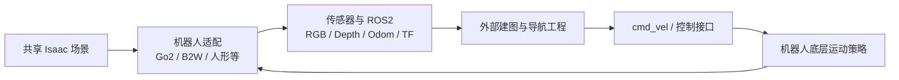

# go2_omniverse

面向四足、轮足、人形等多形态机器人的 Isaac Sim / Isaac Lab 仿真工程，集中管理机器人资产、场景、仿真传感器、底层运动策略和 ROS2 接口。当前统一运行入口提供 Go2 与 B2W 适配，仓库还保留 G1 人形机器人、Crazyflie 的资产和配置。

导航、SRU、建图与部署应用由独立工程通过 ROS2 接入。例如 [thermalnav_demo](https://github.com/L-Anjing/thermalnav_demo) 提供灰度双目稀疏深度、Depth 融合建图和主动探索。

## 1. Pipeline 与功能



本仓库负责仿真侧运行与机器人适配；底层策略在仿真中的推理属于机器人运动控制。导航模型推理、任务评测和实机部署归各自独立工程。双目估计、占据融合及目标选择在外部 C++ `thermalnav_demo` 中运行，SRU 在独立部署工程中将 PointGoal 转为速度指令。

### 机器人适配状态

| 机器人 | 当前实现 | 启动与边界 |
| --- | --- | --- |
| Go2 四足 | Lab MoE-CTS、RGB-D、语义与 LiDAR；可选独立双目建图传感器 | `ROBOT_TYPE=go2`，支持本文 Go2 建图示例 |
| B2W 轮足 | 独立 60D 状态 / 16D 动作策略、RayCaster Depth、RTX RGB、跟随视角 | `ROBOT_TYPE=b2w`，当前统一入口限定 Hospital |
| G1 人形 | `assets/robots/g1/` 资产与 `G1RoughEnvCfg`、agent 配置 | 尚未接入当前 `run_sim.sh` 的机器人选项 |
| Crazyflie 与其他扩展 | `assets/robots/copter/` 等资产配置，按机器人适配层扩展 | 资产存在不等于完成运行入口与闭环验证 |

Go2/B2W 每个进程选择一种机器人，`ROBOT_AMOUNT` 复制该类型；混合机器人同进程生成尚未接入。

| 功能 | 使用方式 / 输出 |
| --- | --- |
| Go2 运动仿真 | Lab MoE-CTS student，接收机体系 `[vx, vy, wz]` |
| 大场景 | Hospital、Warehouse、Office 的 navigation USD 资产 |
| 原前置相机 | RGB、Depth、CameraInfo、语义分割，供现有链路使用 |
| 双目建图传感器 | 可选独立 D455f 参考 Depth 与两只 TWIN612 几何参考 RGB 相机 |
| ROS2 桥接 | 图像、里程计、IMU、LiDAR、TF 和速度控制 |
| 地形速度调节 | 可选 USD 地形限速器，沿用同一个运动策略 |

双目目前使用 RGB 转灰度作为热红外代理，模拟相机几何；热辐射成像和真实热红外噪声不在此代理模型中。

## 2. 环境与构建

### 2.1 运行环境

使用服务器上已有、相互兼容的 Isaac Sim 4.5 / Isaac Lab 环境，以及 ROS2 Humble、Conda 和 NVIDIA GPU。默认 Conda 环境为 `env_isaaclab`，脚本会打印实际 Python、PyTorch、torchvision 路径。

以下示例在 `~/nav_ws` 下组织仓库；服务器已有其他位置时切换到实际仓库目录。

```bash
cd ~/nav_ws/go2_omniverse
source /opt/ros/humble/setup.bash

# 已有依赖目录时无需重复初始化。
git submodule update --init --recursive go2_rl_lab
```

`IsaacSim-ros_workspaces` 在本仓库中是指向服务器已有依赖目录的符号链接。请准备与 Isaac Sim 4.5 配套的 [Isaac ROS2 工作空间](https://github.com/NVIDIA-Omniverse/IsaacSim-ros_workspaces)，并按实际位置调整链接，确保下列检查成功：

```bash
# 新机器按实际依赖路径调整；已有有效链接时无需执行 ln。
ln -sfn /absolute/path/to/IsaacSim-ros_workspaces IsaacSim-ros_workspaces
test -d IsaacSim-ros_workspaces/humble_ws
```

场景 USD、纹理和模型权重需在运行机器上准备齐全；权重由 `checkpoints/.gitignore` 忽略，目录说明随 Git 分发。资产与权重的目录约定、本机清单及归并方法见 [资产管理](assets/README.md) 和 [权重管理](checkpoints/README.md)。

| 路径 | 所需内容 |
| --- | --- |
| `assets/env/big_scene/hospital/hospital_navigation.usda` | Hospital 场景及其引用资产 |
| `assets/env/big_scene/warehouse/warehouse_navigation.usda` | Warehouse 场景及其引用资产 |
| `assets/env/big_scene/office/office_navigation.usda` | Office 场景及其引用资产 |
| `checkpoints/go2/moe_cts/export/policy.pt` | 导出的 Go2 TorchScript student |
| `checkpoints/go2/moe_cts/export/config.yaml` | 与该策略配套的部署配置 |

换机器时设置资产根目录和环境名；脚本默认选择物理 GPU 1，单卡机器通常设为 0：

```bash
export ISAAC_ASSETS_ROOT=/absolute/path/to/Assets/Isaac/4.5
export CONDA_ENV_NAME=env_isaaclab
export CUDA_VISIBLE_DEVICES=0
```

脚本设置 `PYTHONNOUSERSITE=1`，使用 Conda 环境内的 PyTorch / torchvision。

### 2.2 构建 ROS2 工作空间

首次执行 `bash commands/run_sim.sh` 会自动依次构建并加载：

1. `IsaacSim-ros_workspaces/humble_ws`
2. `go2_omniverse_ws`

也可单独构建，先在已配置 ROS2 Humble 和 colcon 的终端执行：

```bash
source /opt/ros/humble/setup.bash
(cd IsaacSim-ros_workspaces/humble_ws && colcon build)
source IsaacSim-ros_workspaces/humble_ws/install/setup.bash
(cd go2_omniverse_ws && colcon build)
source go2_omniverse_ws/install/setup.bash
```

两者已构建后，启动时设置 `SKIP_ROS_BUILD=true` 可复用安装结果。

### 2.3 准备运动策略

已有 `policy.pt` 和配套配置时可直接启动。需要从原始权重重新导出时，准备 `checkpoints/go2/moe_cts/source/moe_cts_lab.pt` 与匹配的 `go2_rl_lab` 源码，在部署 Conda 环境执行：

```bash
conda activate env_isaaclab
PYTHONNOUSERSITE=1 python tools/export_lab_policy.py
```

默认输出至 `checkpoints/go2/moe_cts/export/`；启动时可用 `POLICY_PATH`、`POLICY_CONFIG` 指定其他兼容导出。Go2 使用 45D 单帧观测、10 帧历史、12D 关节动作和 20 ms 控制周期。

### 2.4 离线配置检查

```bash
python3 -m unittest discover -s tests -p test_stereo_camera.py -v
bash -n commands/run_sim.sh
```

该测试检查相机配置、双目基线、TF 几何及发布图契约；实际渲染和闭环导航需在 Isaac 环境验证。C++ 构建和融合测试见 [ThermalNav 使用说明](https://github.com/L-Anjing/thermalnav_demo#使用说明)。

## 3. 使用说明

### 3.1 启动机器人仿真

默认启动单台 Go2、Hospital 场景、Lab 控制器和 ROS2 速度输入：

```bash
ROBOT_TYPE=go2 bash commands/run_sim.sh
```

B2W 使用相同仿真入口：

```bash
ROBOT_TYPE=b2w CUSTOM_ENV=hospital bash commands/run_sim.sh
```

B2W 资产 `assets/robots/b2w/b2w_rsl.usd` 和运动权重 `checkpoints/b2w/locomotion/policy_b2w_new_2.pt` 需在运行机器准备。其 ROS2 命名空间为 `/b2w0`，使用 `/clock` 与仿真时间；传感器内参与 Go2 不同，详见 [B2W 仿真接口](docs/ROBOT_SIM_LOCAL.md)。

无界面运行并复用 ROS2 构建结果：

```bash
HEADLESS=1 SKIP_ROS_BUILD=true CMD_SOURCE=ros2 \
CUSTOM_ENV=hospital bash commands/run_sim.sh
```

| 环境变量 | 默认值 | 用途 |
| --- | --- | --- |
| `ROBOT_TYPE` | `go2` | 仿真机器人；另有 `b2w`，接口见架构说明中的链接 |
| `CUSTOM_ENV` | `hospital` | 场景，可选 `warehouse`、`office` |
| `ROBOT_AMOUNT` | `1` | 同类型机器人数量，Go2 命名空间为 `robot0`、`robot1` 等 |
| `CONTROLLER` | `lab` | Go2 Lab student 控制器 |
| `CMD_SOURCE` | `ros2` | 使用 ROS2 速度指令 |
| `HEADLESS` | `0` | 设为 `1` 关闭窗口 |
| `SKIP_ROS_BUILD` | `false` | 设为 `true` 跳过重建，加载已有安装 |
| `MAX_STEPS` | 未设置 | 可选有限步数运行 |
| `VELOCITY_LOG_INTERVAL` | `5` | 速度日志墙钟间隔，单位秒；`0` 关闭周期日志 |

### 3.2 启用 D455f / TWIN612 参考相机

本节及后续融合示例针对 **Go2**。B2W 使用自己的相机配置；G1 等机器人接入时需单独配置安装位姿、话题及控制策略。

```bash
STEREO_RGB=1 CAMERA_RIG=d455f_twin612 \
bash commands/run_sim.sh
```

| 传感器 | 仿真设置 | 主要话题前缀 |
| --- | --- | --- |
| 原有 SRU 前置相机 | 保持原安装位姿与内参 | `/robot0/front_cam` |
| D455f 参考 Depth | 87° × 58°、0.6–6 m；HD 几何以 640 × 360 渲染 | `/robot0/d455f_depth` |
| 左右 TWIN612 RGB 灰度代理 | 640 × 512、12 μm 像元、25 mm 镜头 | `/robot0/twin612_left`、`/robot0/twin612_right` |

热红外双目基线暂定 **120 mm**。镜头为已选 **25 mm**；基线和安装位置为仿真暂定值，实机安装后需标定。参数统一位于 [configs/robot_extrinsic.yaml](configs/robot_extrinsic.yaml)，也可覆盖：

```bash
STEREO_RGB=1 CAMERA_RIG=d455f_twin612 \
STEREO_BASELINE=0.12 THERMAL_LENS_MM=25 \
bash commands/run_sim.sh
```

`STEREO_BASELINE` 单位为米。渲染相机与静态 TF 共用同一外参配置，坐标关系为 `p_base = R_camera_to_base × p_camera + t_camera_to_base`；机体系 x 前、y 左、z 上，相机光学系 x 右、y 下、z 前。修改后重启仿真。

如需沿用原前置相机作为左目，只增加右目：

```bash
STEREO_RGB=1 CAMERA_RIG=legacy bash commands/run_sim.sh
```

### 3.3 运行 C++ 融合与探索

仿真保持运行，在另一个终端执行：

```bash
cd ~/nav_ws/thermalnav_demo
bash run_demo.sh build
CAMERA_RIG=d455f_twin612 MAPPING_SOURCE=fused bash run_demo.sh observe
```

随后在其他终端执行：

```bash
cd ~/nav_ws/thermalnav_demo
bash run_demo.sh rviz
# 开始探索 / 查看状态 / 停止
bash run_demo.sh start
bash run_demo.sh status
bash run_demo.sh stop
```

`observe` 先观测建图，`start` 开启探索；`MAPPING_SOURCE` 支持 `depth_only`、`stereo_only`、`fused`。两端 `CAMERA_RIG` 应一致。Go2 链路保持 `use_sim_time=false`。

评测稀疏深度时，仿真启动命令额外设置 `CAMERA_EVAL_GT=1`，再运行：

```bash
CAMERA_RIG=d455f_twin612 bash run_demo.sh evaluate
```

该开关发布 `/robot0/twin612_left/depth_reference`，仅供独立评测使用。普通融合使用左右 RGB 估计稀疏深度。

### 3.4 ROS2 接口与手动控制

| 接口 | 话题 |
| --- | --- |
| 速度输入 `Twist` | `/robot0/cmd_vel` |
| 位姿、惯性和 LiDAR | `/robot0/odom`、`/robot0/imu`、`/robot0/point_cloud2_L1` |
| 原前置 RGB-D | `/robot0/front_cam/rgb`、`depth`、`camera_info` |
| 原前置语义 | `/robot0/front_cam/semantic_segmentation`、`semantic_segmentation_labels` |
| 独立建图 Depth | `/robot0/d455f_depth/depth`、`camera_info` |
| 独立双目 RGB | `/robot0/twin612_left/rgb`、`camera_info`；右目对应 `twin612_right` |
| 指令诊断 `TwistStamped` | `/robot0/requested_command`、`/robot0/controller_command` |

表中同一前缀下省略的名称均为该前缀的子话题。原 `front_cam/depth` 始终发布。手动控制时停止其他速度发送端，再运行：

```bash
ros2 run teleop_twist_keyboard teleop_twist_keyboard \
  --ros-args -r cmd_vel:=/robot0/cmd_vel
```

### 3.5 地形、摩擦与场景配置

```bash
TERRAIN_SPEED_LIMIT=1 bash commands/run_sim.sh

GROUND_STATIC_FRICTION=0.9 GROUND_DYNAMIC_FRICTION=0.8 \
TERRAIN_SPEED_LIMIT=1 bash commands/run_sim.sh
```

地形限速默认关闭；配置位于 [configs/terrain_speed.yaml](configs/terrain_speed.yaml)，可通过 `TERRAIN_SPEED_CONFIG` 切换。它在底层运动策略之前调节速度请求；地形配置值属于仿真参数。地面摩擦默认静摩擦 `0.9`、动摩擦 `0.8`，要求 `0 ≤ 动摩擦 ≤ 静摩擦`。

场景使用 `assets/env/big_scene/<场景>/<场景>_navigation.usda` 及其引用资产。Hospital / Warehouse 正式入口检查对应标注资产。生成 Hospital 导航 overlay：

```bash
python tools/usd_scene_pipeline.py navigation-overlay \
  assets/env/big_scene/hospital/hospital_base.usd \
  --output assets/env/big_scene/hospital/hospital_navigation.usda \
  --json assets/env/big_scene/hospital/hospital_navigation.json \
  --open-doors --all-semantics
```

语义标注施加到实际渲染 Mesh：地面为 `floor`，踏步为 `stairs`，墙体与栏杆为 `wall`，标志为 `sign`。`--open-doors` 停用门板并保留门框。

## 4. 工程架构

```text
go2_omniverse/
├── main.py                       # 仿真入口
├── commands/                     # 启动、训练转发及兼容入口
│   └── run_sim.sh                # ROS2 构建、环境加载、仿真启动
├── core/
│   ├── omniverse_sim.py          # 场景、机器人、仿真主循环
│   ├── ros2.py                   # ROS2 节点、传感器和 TF
│   ├── omnigraph.py              # 图像、深度、标定和语义发布图
│   ├── camera_extrinsic.py       # 相机内外参、双目基线和几何配置
│   ├── robot_profiles.py         # 机器人类型、命名空间和接口配置
│   ├── lab_policy.py             # Go2 Lab student 推理和历史管理
│   ├── b2w_policy.py             # B2W 轮足运动策略
│   ├── b2w_*camera.py            # B2W RGB 与跟随视角
│   └── terrain_*.py / usd_terrain.py  # 地形查询与速度调节
├── configs/                      # 机器人部署、相机、地形配置
├── assets/robots/                # b2w / g1 / copter 的模型与配置
├── assets/env/                   # 共享场景 USD 与引用资产
├── checkpoints/<机器人>/<策略>/  # 运动权重和导出配置（内容 Git 忽略）
├── go2_omniverse_ws/              # 自定义 ROS2 消息包 go2_interfaces
├── IsaacSim-ros_workspaces/       # Isaac ROS2 依赖工作空间
├── go2_rl_lab/                   # 策略导出与训练所需上游源码
├── tools/                        # 权重导出、场景标注与资产处理
├── tests/test_stereo_camera.py   # 无 Isaac 运行时的相机配置测试
└── docs/                         # 控制器与机器人接口补充说明
```

`thermalnav_demo` 和 `sru-robot-deployment` 是独立工程，通过 ROS2 与仿真通信。本仓库的启动脚本只启动仿真；导航节点、SRU 评测与实机应用由外部部署入口管理。

新增机器人时，在 `assets/robots/<类型>/` 准备资产，配置对应关节 / 执行器与运动策略，再接入机器人类型选择、ROS2 命名空间、传感器及 TF。需要分别验证模型加载、站立 / 行走、相机几何和外部控制链路。

更多接口与参数见 [机器人与 B2W 使用说明](docs/ROBOT_SIM_LOCAL.md)、[地形限速说明](docs/terrain_speed.md) 和 [Lab 部署细节](docs/lab_controller.md)。
